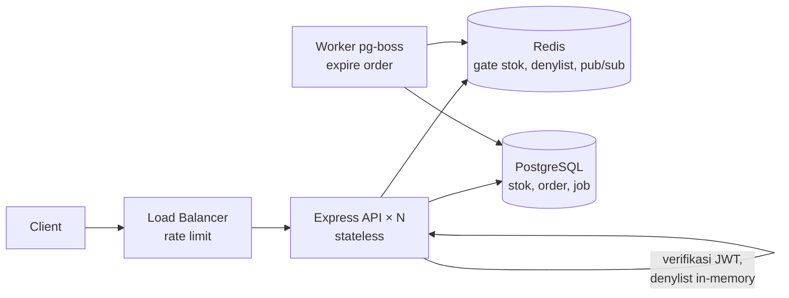
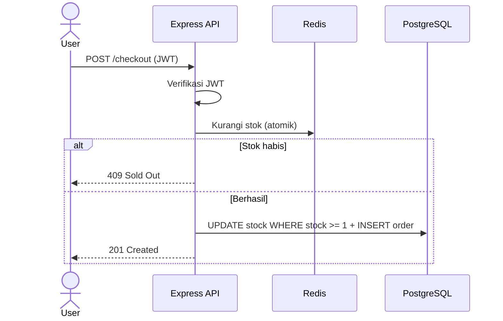
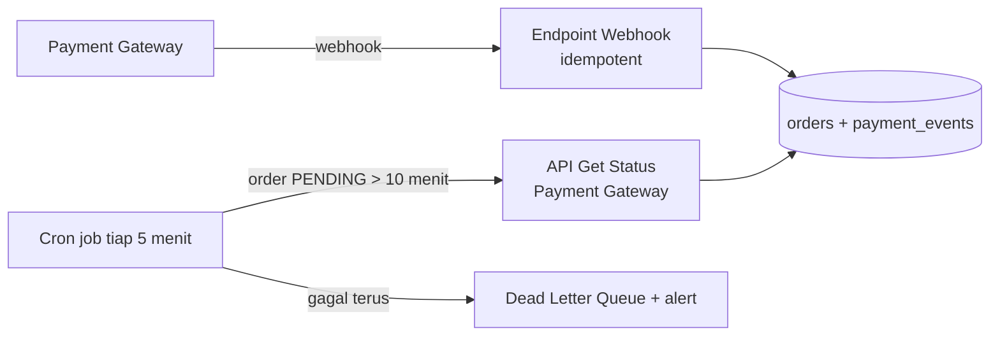

# Work Sample Test — Fullstack Development & Business Systems

| | |
|---|---|
| **Nama Kandidat** | Eastyanda Putra Kesuma |
| **Posisi** | Fullstack React Engineer |
| **Tanggal** | 10 Oktober 2026 |

## Daftar Isi

- [Cara Menjalankan Aplikasi](#cara-menjalankan-aplikasi)
- [Soal #1 — Optimasi Performa & State Management React](#soal-1--optimasi-performa--state-management-react)
- [Soal #2 — Arsitektur Backend, JWT, & High-Concurrency](#soal-2--arsitektur-backend-jwt--high-concurrency)
- [Soal #3 — Integrasi API, Webhook Reliability, & Resiliency](#soal-3--integrasi-api-webhook-reliability--resiliency)
- [Soal #4 — TCO & Trade-off Monolith vs Microservices](#soal-4--tco--trade-off-monolith-vs-microservices)
- [Soal #5 — Prioritisasi Fitur, LTV/CAC, & Tech Debt](#soal-5--prioritisasi-fitur-ltvcac--tech-debt)

---

## Cara Menjalankan Aplikasi

Prasyarat: Node.js ≥ 20 (atau Bun ≥ 1.2).

```bash
# dengan npm
npm install
npm run dev

# atau dengan bun
bun install
bun run dev
```

| Script | Fungsi |
|---|---|
| `dev` | Menjalankan dev server Vite |
| `build` | Type-check (`tsc`) lalu build production ke `dist/` |
| `start` | Preview hasil build |
| `test` | Unit test (Vitest) untuk store & batcher |
| `typecheck` | Type-check TypeScript saja |

**Stack:** React 18 + TypeScript, Vite, Tailwind CSS v4, Zustand (state management), react-window (virtualization), Vitest.

---

## Soal #1 — Optimasi Performa & State Management React

Source code ada di folder [`/src`](src). Aplikasinya menampilkan **5.000 produk** dengan update stok real-time (simulasi WebSocket). Ada dua mode yang bisa dibandingkan:

- **Optimized** — versi solusi.
- **Naive** — versi yang meniru masalah di soal, sebagai pembanding.

Setiap baris punya kolom **Renders** (berapa kali baris itu di-render), dan di header ada **FPS meter**, supaya perbedaannya bisa dilihat langsung.

### 1. Penyebab unnecessary re-render

1. **Semua data produk disimpan di state komponen induk.** Saat 1 item berubah, array produk diganti dengan array baru, induk re-render, dan karena re-render di React menjalar ke bawah, 5.000 row ikut re-render.
2. **Row tidak di-memo.** Tanpa `React.memo`, row tetap dirender ulang walaupun datanya tidak berubah.
3. **Props selalu punya referensi baru.** Inline function (`onClick={() => ...}`) atau object baru di setiap render membuat `React.memo` tidak berguna, karena perbandingan props selalu dianggap berbeda.
4. **Semua row dirender ke DOM.** 5.000 row dirender sekaligus, padahal yang terlihat di layar hanya belasan.
5. **Setiap pesan real-time langsung memicu `setState`.** Ratusan update per detik berarti ratusan kali render ulang seluruh tabel.

Versi yang meniru masalah ini ada di [`naive-product-dashboard.tsx`](src/modules/product/components/dashboard/naive-product-dashboard.tsx).

### 2. Implementasi solusi

**a. Row membaca datanya sendiri dari store + `React.memo`** — [`product-row.tsx`](src/modules/product/components/table/product-row.tsx)

```tsx
export const ProductRow = memo(function ProductRow({ index, style, data }: ListChildComponentProps<ProductRowData>) {
    const id = data.ids[index];
    const product = useProductStore((state) => state.byId[id]); // hanya data row ini
    const isSelected = useProductStore((state) => state.selectedId === id);
    const selectProduct = useProductStore((state) => state.selectProduct);

    const handleSelect = useCallback(() => selectProduct(id), [selectProduct, id]);

    return (
        <div style={style} onClick={handleSelect}>
            <span>{product.name}</span>
            <span>{product.stock}</span>
            {/* ... */}
        </div>
    );
}, areEqual);
```

Row hanya menerima `id`, lalu mengambil datanya sendiri lewat selector. Jadi saat stok produk X berubah, hanya row X yang re-render.

**b. Virtualization dengan react-window** — [`product-table.tsx`](src/modules/product/components/table/product-table.tsx)

```tsx
export const ProductTable = memo(function ProductTable({ ids }: ProductTableProps) {
    const itemData = useMemo(() => ({ ids }), [ids]);

    return (
        <FixedSizeList height={560} width="100%" itemCount={ids.length} itemSize={48} itemData={itemData}>
            {ProductRow}
        </FixedSizeList>
    );
});
```

Hanya row yang terlihat (±20) yang ada di DOM. `itemData` dibungkus `useMemo` supaya referensinya stabil dan tidak memicu render ulang semua row.

**c. Batching update real-time** — [`frame-batcher.ts`](src/libs/frame-batcher.ts)

Pesan dari socket tidak langsung di-`setState`. Pesan ditampung dulu, lalu disimpan ke store sekali per frame (`requestAnimationFrame`). Jadi walaupun ada 1.000 pesan per detik, store hanya di-update ±60 kali per detik.

### 3. Strategi state management

Data disimpan di **Zustand** dengan bentuk ternormalisasi:

```ts
interface ProductStoreState {
    ids: string[];                  // urutan produk
    byId: Record<string, IProduct>; // data produk per id
    // ...
}
```

- Saat stok 1 produk berubah, yang diganti hanya object produk itu. `ids` dan object produk lain tetap sama, sehingga komponen yang membacanya tidak re-render.
- Setiap komponen hanya mengambil data yang dibutuhkan lewat selector: row mengambil `byId[id]`, kartu summary mengambil satu angka, dan tabel hanya mengambil `ids`.
- Saya tidak memakai React Context untuk data ini, karena setiap perubahan value Context akan me-render ulang semua komponen yang memakainya.
- State yang hanya dipakai di satu tempat (input pencarian, filter) tetap disimpan sebagai `useState` lokal.

### 4. Hasil

| | Naive | Optimized |
|---|---|---|
| Row yang re-render per 1 update stok | 5.000 | 1 |
| Row yang ada di DOM | 5.000 | ±20 |

Cara mengecek: jalankan `npm run dev`, set feed ke 1.000/s. Di mode **Optimized**, kolom Renders hanya naik di baris yang stoknya berubah dan FPS tetap stabil. Di mode **Naive**, semua baris ikut naik dan scroll terasa lag.

---

## Soal #2 — Arsitektur Backend, JWT, & High-Concurrency

### 1. Tech stack

**Node.js + Express + TypeScript**, dengan **PostgreSQL** sebagai database utama, **Redis** untuk cache/gate stok/denylist token, dan **pg-boss** untuk background job.

Alasan:

- **Satu bahasa dengan frontend.** Tipe data dan schema validasi (Zod) bisa dipakai bersama FE & BE, sehingga kontrak API konsisten.
- **Cocok untuk beban I/O tinggi.** Flash sale didominasi menunggu database/Redis, bukan komputasi berat. Event loop Node.js efisien menangani ribuan koneksi bersamaan.
- **Stateless, mudah di-scale horizontal.** Tidak ada session di memori, jadi kapasitas dinaikkan cukup dengan menambah instance di belakang load balancer.

API untuk frontend memakai **REST + JSON**, karena mudah di-cache, mudah di-debug, dan langsung didukung browser. gRPC baru dipertimbangkan untuk komunikasi internal antar-service bila nanti ada service yang dipisah.

### 2. Token revocation tanpa merusak sifat stateless

1. **Access token berumur pendek (10–15 menit).** Diverifikasi hanya lewat signature, tanpa lookup ke database.
2. **Refresh token disimpan di cookie `httpOnly`, dan hash-nya dicatat di database.** Refresh token diganti setiap dipakai. Saat logout, refresh token dihapus sehingga user tidak bisa mendapat access token baru.
3. **Denylist `jti` di Redis dengan TTL = sisa umur access token**, untuk mematikan access token yang masih aktif saat logout. Denylist kecil karena entri hilang otomatis begitu token expired.
4. **Supaya tetap stateless,** denylist disalin ke memori tiap instance API lewat Redis Pub/Sub. Pengecekan per request cukup lookup di memori, tanpa network call.

```ts
// middleware auth
const payload = await verifyJwt(token); // cek signature + exp (stateless)
if (revokedJti.has(payload.jti)) return res.status(401).json({ message: 'Token revoked' });

// logout
await redis.set(`revoked:${jti}`, '1', 'EX', exp - nowInSeconds()); // hilang sendiri saat token expired
await redis.publish('token-revoked', jti); // semua instance memperbarui cache memorinya
await refreshTokenRepo.delete(userId, refreshToken);
```

### 3. Race condition: 100 user membeli 1 sisa barang

**Penyebab:** pola baca-cek-tulis yang terpisah. 100 request membaca `stock = 1` bersamaan, semuanya lolos pengecekan, sehingga terjadi overselling.

**Solusi utama (PostgreSQL): atomic conditional update.** Cek dan kurangi stok dalam satu statement di dalam transaksi:

```sql
BEGIN;
UPDATE products SET stock = stock - 1
 WHERE id = $1 AND stock >= 1;      -- 0 row affected → stok habis → 409 Sold Out
INSERT INTO orders (...) VALUES (...);
COMMIT;
```

`UPDATE` mengunci row tersebut. Transaksi lain mengantre, dan setelah transaksi pertama commit, kondisi `stock >= 1` dievaluasi ulang terhadap nilai terbaru (`0`). Hasilnya hanya **1 user** yang berhasil, 99 lainnya mendapat `409`. Sebagai pengaman tambahan: constraint `CHECK (stock >= 0)`.

**Untuk skala flash sale: Redis sebagai gate.** Ribuan request yang mengantre lock di satu row bisa menghabiskan connection pool database. Karena itu stok di-preload ke Redis dan dikurangi secara atomik dengan Lua script (cek stok > 0, lalu kurangi, dalam satu operasi). Hanya request yang berhasil mengurangi stok di Redis yang diteruskan ke PostgreSQL; sisanya langsung ditolak tanpa menyentuh database. PostgreSQL tetap menjadi source of truth. Kalau transaksi di PostgreSQL gagal, stok di Redis dikembalikan (`INCR`) supaya tidak ada stok yang "hilang".

**Order yang tidak dibayar** berstatus `PENDING_PAYMENT` selama 15 menit. Job expire dijadwalkan via pg-boss di dalam transaksi yang sama dengan pembuatan order, ditambah cron sweep sebagai cadangan, untuk membatalkan order dan mengembalikan stok.

### 4. Diagram arsitektur





---

## Soal #3 — Integrasi API, Webhook Reliability, & Resiliency

### 1. Idempotency pada endpoint webhook

Payment gateway bisa mengirim webhook yang sama lebih dari sekali (retry karena timeout), jadi endpoint harus aman bila menerima event yang sama berkali-kali. Caranya:

1. **Verifikasi signature dulu.** Cek signature/HMAC dari header webhook agar request palsu ditolak.
2. **Simpan event ID yang sudah diproses.** Setiap webhook punya ID unik dari payment gateway (misalnya `transaction_id` + status). ID ini disimpan di tabel `payment_events` dengan constraint `UNIQUE`. Kalau insert gagal karena duplikat, berarti event sudah pernah diproses, dan endpoint langsung membalas `200 OK` tanpa memproses ulang.
3. **Update status order secara kondisional.** Order hanya diubah jika statusnya masih `PENDING_PAYMENT`, jadi order yang sudah `PAID` tidak diproses dua kali. Nominal di webhook juga dicocokkan dengan nominal order sebelum ditandai lunas.
4. **Semua dilakukan dalam satu transaksi database**, dan endpoint membalas cepat. Proses lanjutan (kirim email, dsb.) dijadwalkan sebagai job, bukan dikerjakan di dalam request webhook.

```ts
app.post('/webhooks/payment', async (req, res) => {
    if (!verifySignature(req)) return res.status(401).end();

    const { transactionId, orderId, status } = req.body;

    await db.transaction(async (tx) => {
        const inserted = await tx.query(
            `INSERT INTO payment_events (event_id, order_id, status, payload)
             VALUES ($1, $2, $3, $4)
             ON CONFLICT (event_id) DO NOTHING`,
            [`${transactionId}:${status}`, orderId, status, req.body]
        );
        if (inserted.rowCount === 0) return;

        if (status === 'settlement') {
            await tx.query(
                `UPDATE orders SET status = 'PAID', paid_at = now()
                  WHERE id = $1 AND status = 'PENDING_PAYMENT'`,
                [orderId]
            );
        }
    });

    res.status(200).json({ received: true });
});
```

### 2. Fallback untuk pembayaran yang menggantung

Webhook tidak bisa dijadikan satu-satunya sumber status, karena bisa gagal sampai ke server kita. Jadi ada beberapa lapisan cadangan:

1. **Retry dari payment gateway.** Kebanyakan payment gateway (Midtrans, Xendit, Stripe) otomatis mengirim ulang webhook bila tidak menerima `200`. Karena endpoint sudah idempotent, retry ini aman.
2. **Cron job untuk cek status secara aktif.** Setiap beberapa menit, job (pg-boss, sama seperti Soal #2) mengambil order yang masih `PENDING_PAYMENT` lebih dari X menit, lalu memanggil API *Get Transaction Status* dari payment gateway. Hasilnya diproses lewat fungsi yang sama dengan webhook, jadi tetap idempotent.
3. **Retry dengan backoff dan Dead Letter Queue.** Kalau pengecekan gagal (misalnya API payment gateway sedang down), job di-retry dengan jeda yang makin lama (1 menit, 5 menit, 15 menit, ...). Setelah batas retry habis, job dipindah ke dead letter queue dan tim mendapat alert untuk dicek manual.
4. **Expire order.** Order yang tetap tidak dibayar sampai batas waktu dibatalkan dan stoknya dikembalikan (sudah dijelaskan di Soal #2). Kalau ternyata pembayaran masuk **setelah** order di-expire, event itu tidak boleh diabaikan karena uang user sudah terpotong. Sistem mencoba memesan ulang stoknya; kalau stok sudah habis, dana di-refund otomatis dan user diberi notifikasi.



### 3. Komunikasi status pembayaran ke frontend

| Opsi | Kelebihan | Kekurangan |
|---|---|---|
| Polling | Paling sederhana | Banyak request yang sia-sia, update tidak langsung |
| WebSocket | Real-time dua arah | Lebih kompleks, butuh koneksi stateful, berlebihan karena hanya butuh server → client |
| **Server-Sent Events (SSE)** | Real-time satu arah, pakai HTTP biasa, browser otomatis reconnect | Hanya satu arah (cukup untuk kasus ini) |

Saya memilih **SSE**, karena frontend hanya perlu menerima perubahan status dari server, tidak perlu mengirim data balik. Alurnya:

1. Setelah checkout, halaman pembayaran membuka koneksi SSE ke `GET /orders/:id/payment-status/stream`. Karena `EventSource` tidak bisa mengirim header `Authorization`, autentikasinya memakai cookie, dan server memastikan order tersebut milik user yang login.
2. Saat webhook (atau cron) mengubah status order, backend mengirim event ke koneksi tersebut. Kalau backend punya beberapa instance, event disebar lewat Redis Pub/Sub.
3. Frontend menampilkan status (*Menunggu pembayaran → Berhasil / Gagal / Kedaluwarsa*), lalu menutup koneksi begitu status final.
4. **Fallback:** kalau koneksi SSE putus, frontend reconnect dengan backoff. Saat tersambung kembali, frontend mengambil status terbaru lewat `GET /orders/:id` agar tidak ada update yang terlewat. Kalau SSE tidak bisa dipakai sama sekali, frontend beralih ke polling dengan interval yang makin jarang (3 detik, 5 detik, 10 detik).

```ts
// hooks/use-payment-status.ts
export function usePaymentStatus(orderId: string) {
    const [status, setStatus] = useState<PaymentStatus>('PENDING_PAYMENT');

    useEffect(() => {
        const source = new EventSource(`/api/orders/${orderId}/payment-status/stream`, { withCredentials: true });

        source.addEventListener('status', (event) => {
            const next = JSON.parse((event as MessageEvent).data).status as PaymentStatus;
            setStatus(next);
            if (next !== 'PENDING_PAYMENT') source.close(); // status final → tutup koneksi
        });

        return () => source.close();
    }, [orderId]);

    return status;
}
```

---

## Soal #4 — TCO & Trade-off Monolith vs Microservices

### 1. Analisis TCO: apakah migrasi ini menguntungkan?

Menurut saya **tidak, untuk startup skala awal–menengah**, kecuali ada masalah nyata yang tidak bisa diselesaikan dengan monolith.

Perkiraan kasar biaya infrastruktur per bulan (harga AWS, bisa berbeda tergantung region dan pemakaian):

| Komponen | Monolith (sekarang) | Microservices (usulan) |
|---|---|---|
| Server / compute | ±$150 (semua sudah termasuk) | EKS control plane ±$73 + 3 worker node ±$100–150 |
| Database | (di server yang sama / 1 DB) | Managed DB per service, misalnya 3 × RDS ±$50–150 = $150–450 |
| Network | — | Load balancer ±$20 + NAT Gateway ±$35 + biaya transfer data antar-service |
| Lambda, queue, API Gateway | — | ±$20–100 tergantung traffic |
| Monitoring & logging | sederhana | Centralized logging & tracing ±$50–200 |
| **Total infrastruktur** | **±$150** | **±$450–1.100 (3–7× lipat)** |

Biaya terbesarnya justru bukan di server, tapi di **orang**:

- Butuh minimal 1 orang yang paham Kubernetes, CI/CD multi-service, dan monitoring. Gaji 1 engineer per bulan jauh lebih besar dari selisih biaya server.
- Selama migrasi (biasanya berbulan-bulan), tim lebih banyak mengerjakan infrastruktur daripada fitur baru. Untuk startup, kehilangan kecepatan rilis fitur adalah biaya yang paling mahal.

Jadi TCO-nya naik berlipat, sementara keuntungannya (scale per service, deploy independen) baru terasa kalau tim dan traffic sudah besar.

### 2. Hidden cost microservices

**Infrastruktur:**

- Biaya dasar yang tetap jalan walaupun traffic kecil: control plane Kubernetes, NAT Gateway, load balancer, dan database per service.
- Biaya transfer data antar-service dan antar-availability zone.
- Banyak environment (dev, staging, production) yang masing-masing butuh semua service ikut berjalan.
- Tools tambahan: service discovery, centralized logging, distributed tracing, secret management.

**Operasional tim engineering:**

- **Debugging lebih sulit.** Satu request melewati beberapa service, sehingga mencari sumber error butuh tracing.
- **Konsistensi data.** Transaksi yang dulu cukup satu `BEGIN ... COMMIT` sekarang tersebar di beberapa database, sehingga butuh pola seperti saga atau event, yang lebih rumit dan rawan bug.
- **Kontrak API antar-service** harus dijaga versinya. Perubahan kecil bisa memerlukan koordinasi beberapa service.
- **Testing lebih berat.** Integration test dan local development harus menjalankan banyak service sekaligus.
- **Kebutuhan skill DevOps/SRE**, plus waktu untuk on-call dan maintenance cluster.

### 3. Rekomendasi: Modular Monolith

Tetap **satu aplikasi dan satu database**, tapi kode dipecah per domain bisnis dengan batasan yang jelas:

```
src/modules/
├─ auth/       # login, JWT, refresh token
├─ catalog/    # produk, kategori
├─ inventory/  # stok, flash sale
├─ order/      # checkout, order
└─ payment/    # integrasi payment gateway, webhook
```

- Setiap modul hanya boleh mengakses modul lain lewat interface/service yang di-export, bukan langsung ke tabel milik modul lain.
- Tetap satu kali deploy dan satu transaksi database, sehingga cepat dikembangkan dan murah dijalankan.
- Scaling cukup dengan menambah instance aplikasi di belakang load balancer (aplikasinya sudah stateless, lihat Soal #2), plus Redis dan background worker yang sudah ada.

Perkiraan biaya: tetap di kisaran **±$150–300/bulan** (2 instance aplikasi + managed database + Redis kecil), dan bisa naik bertahap sesuai traffic.

**Kapan baru memecah jadi service terpisah?** Hanya untuk modul yang punya alasan jelas. Misalnya:

- modul `payment` butuh deploy dan keamanan yang terpisah;
- satu bagian butuh scaling sangat berbeda dari bagian lain;
- tim sudah cukup besar sehingga sering saling menunggu saat deploy.

Karena batas antar-modul sudah rapi, modul tersebut bisa dipindah menjadi service sendiri tanpa menulis ulang seluruh aplikasi.

---

## Soal #5 — Prioritisasi Fitur, LTV/CAC, & Tech Debt

### 1. Mengkomunikasikan dampak technical debt ke PM & stakeholder non-teknis

Kuncinya adalah **tidak membahas istilah teknis, tapi membahas risiko bisnis dalam angka**. Stakeholder tidak perlu tahu detail kodenya; mereka perlu tahu apa yang dipertaruhkan.

1. **Terjemahkan ke dampak bisnis.** Contoh: bukan "connection pool database kita bocor", tapi *"Saat traffic naik 3× (misalnya waktu promo), ada risiko server down. Kalau down 2 jam saat promo, perkiraan kehilangan transaksi sekitar Rp X juta."*
2. **Bawa data, bukan opini.** Misalnya jumlah insiden/error dalam 1–3 bulan terakhir, waktu respon yang makin lambat, atau berapa lama fitur terakhir tertunda karena kodenya sulit diubah.
3. **Hubungkan dengan target mereka.** Fitur baru untuk menurunkan CAC tidak ada gunanya kalau user baru datang lalu server down. Biaya iklan untuk mendatangkan mereka jadi terbuang.
4. **Datang dengan pilihan, bukan hanya masalah.** Misalnya:
   - *Opsi A:* 3 fitur jalan semua, tech debt diabaikan → risiko down tetap tinggi.
   - *Opsi B:* 2 fitur prioritas + perbaikan tech debt yang paling kritis → risiko turun, 1 fitur mundur ke sprint berikutnya.

   Lalu biarkan PM ikut memutuskan dengan informasi yang lengkap.

### 2. Hubungan kualitas sistem dengan Churn Rate & LTV

- **Churn Rate** adalah persentase user yang berhenti memakai produk dalam periode tertentu.
- **LTV (Customer Lifetime Value)** adalah total pendapatan dari satu customer selama dia masih menjadi customer. Rumus sederhananya: `LTV ≈ rata-rata pendapatan per user per bulan ÷ churn rate bulanan` (lebih tepatnya pendapatan dikali gross margin, supaya yang dihitung adalah keuntungan).
- **CAC** adalah biaya untuk mendapatkan satu customer baru. Bisnis dianggap sehat bila **LTV jauh lebih besar dari CAC** (umumnya minimal 3:1).

Hubungannya dengan kualitas sistem:

- Sistem yang sering error, lambat, atau down → user kecewa (misalnya checkout gagal atau pembayaran tidak ter-update) → **churn naik**.
- Karena churn ada di pembagi rumus LTV, **churn yang naik membuat LTV turun**. Contoh: pendapatan Rp100.000/user/bulan, churn 5% → LTV Rp2 juta. Kalau churn naik jadi 10% → LTV turun jadi Rp1 juta.
- Akibatnya rasio LTV:CAC memburuk. Uang yang dipakai untuk mendatangkan user (CAC) tidak sempat kembali.
- Kode yang penuh tech debt juga membuat fitur baru lebih lama dikerjakan dan lebih sering menimbulkan bug, sehingga kemampuan tim untuk bersaing ikut turun.

Kesimpulannya, **menurunkan CAC tanpa menjaga reliabilitas sama seperti mengisi ember yang bocor**: user baru masuk, tapi user lama terus keluar.

### 3. Framework pembagian kapasitas sprint

Langkah yang saya pakai:

1. **Tangani dulu tech debt yang berisiko menyebabkan server down.** Ini diperlakukan seperti bug kritis dan dikerjakan di awal sprint, tidak bisa ditunda.
2. **Tetapkan alokasi kapasitas tetap** untuk sprint biasa. Contohnya **70% fitur bisnis, 20% tech debt, 10% bug/maintenance**. Dengan aturan ini, tech debt dicicil terus dan tidak menumpuk, tanpa harus "berebut" setiap sprint.
3. **Prioritaskan item menggunakan skor sederhana**, misalnya *Impact × Urgency ÷ Effort*, untuk fitur maupun tech debt. Dengan begitu keduanya dinilai dengan ukuran yang sama.
4. **Kalau perlu, sesuaikan alokasi sementara.** Karena di kasus ini ada risiko server down, sprint ini porsi tech debt dinaikkan menjadi **±40%** (lihat contoh di bawah), lalu kembali ke 70/20/10 setelah risiko kritis teratasi.
5. **Gabungkan bila memungkinkan.** Refactor bagian kode yang memang akan disentuh oleh fitur baru, jadi fitur dan perbaikan bisa jalan bersamaan.

Contoh penerapan untuk sprint ini (sprint 2 minggu):

| Item | Kategori | Porsi |
|---|---|---|
| Perbaiki penyebab risiko server down (misalnya query berat, memory leak) + tambah monitoring & alert | Tech debt kritis | ±40% |
| Fitur #1 (dampak terbesar ke CAC) | Fitur | ±30% |
| Fitur #2 | Fitur | ±30% |
| Fitur #3 | Fitur | Dipindah ke sprint berikutnya |

Setelah sprint selesai, hasilnya dilaporkan ke stakeholder (misalnya jumlah error turun atau server tetap stabil saat traffic naik), supaya alokasi waktu untuk tech debt berikutnya lebih mudah disetujui.
